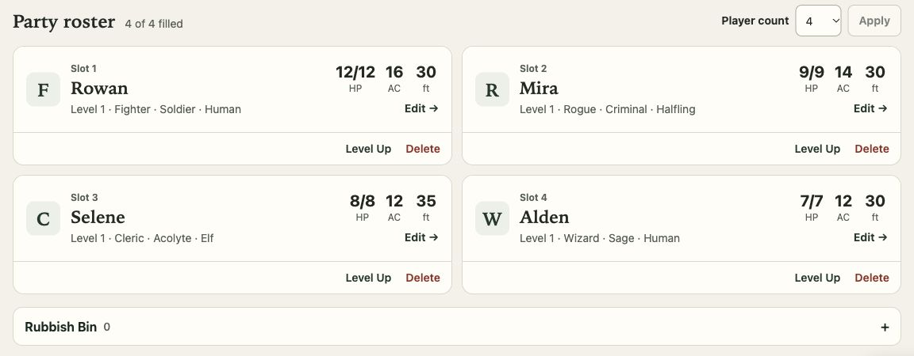
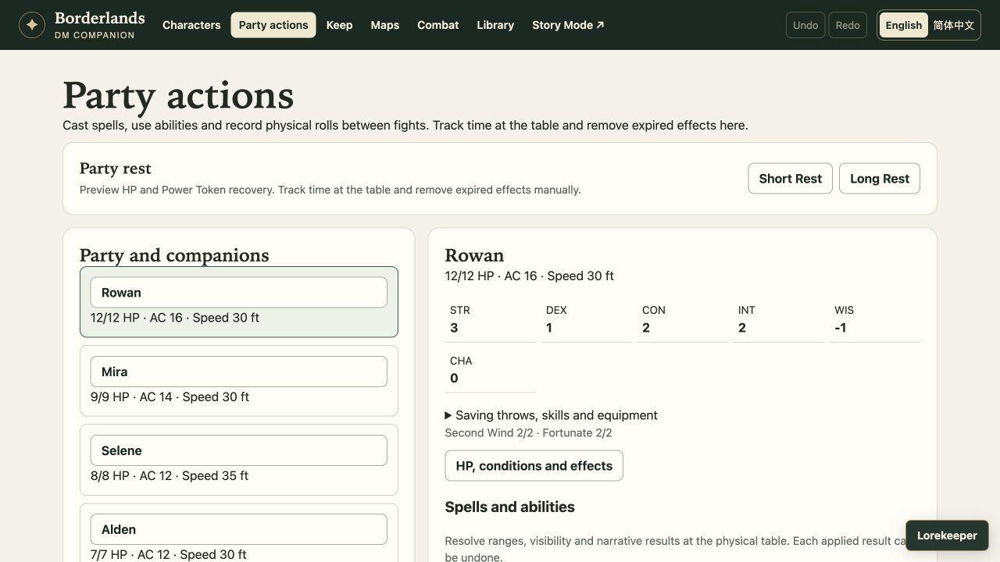
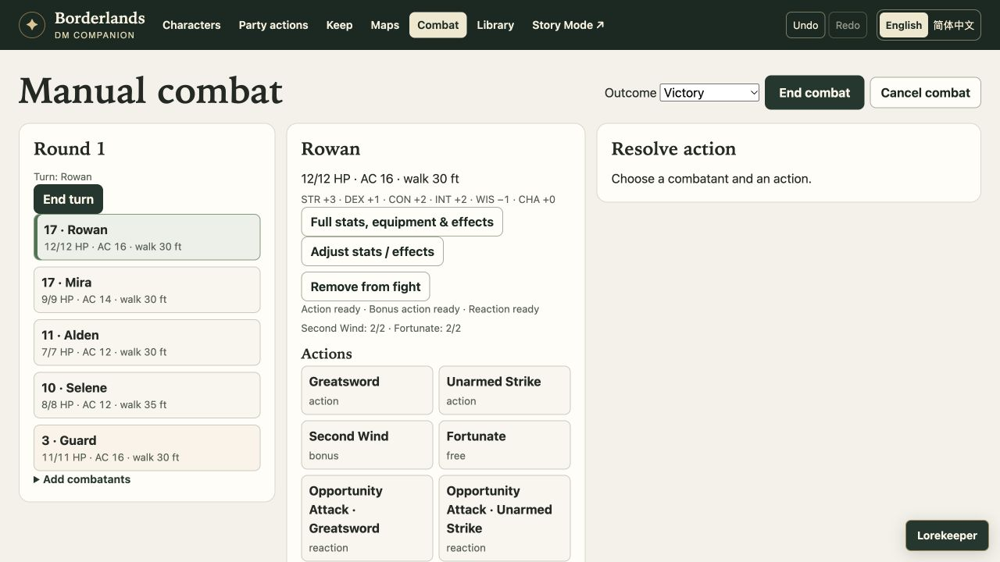
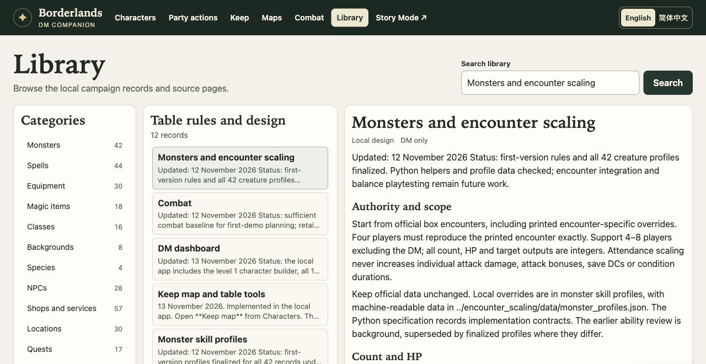

# Borderlands DM Companion

A local dashboard for a human Dungeon Master running a cooperative, physical-table game for **4–8 players**.

**Download:** [Latest release](https://github.com/Binjie-Tony-Tang/borderlands-dm-companion/releases/latest). The release includes a public source ZIP, checksum and setup notes; compatible private content and adapters are required for the full dashboard.

This project began as a practical way for a new DM to keep character sheets, encounter preparation, rules references and session bookkeeping within reach. The private application uses the **Heroes of the Borderlands** starter set as its starting point, with a separately documented set of attendance adjustments for a larger group.

The DM still runs the game: players choose their actions, people roll physical dice, miniatures move on the table, and the DM decides what happens in the fiction. The dashboard records choices and rolls, calculates supported consequences, and makes relevant information easier to find. Its optional Lorekeeper offers reference-based explanations and clearly identified advice.

## Source release and private content

**This repository publishes application source and original project work. The complete dashboard requires a separate private content pack.** The public source includes the local-server framework, reusable UI and state handling, combat/effect engine and attendance-scaling algorithms. The existing starter-set integration also depends on data and descriptors that remain in the owner's private installation.

Official books, card sheets, adventure maps, artwork, rule transcriptions, translations of that material, creature profiles and embedded rule/adventure content are excluded. This applies to data inside JavaScript as well as files under `database/`: moving a card description into a source-code file does not make it part of the public source release. Personal campaign saves and credentials are also excluded.

No public software license has been selected yet. This source release does not grant rights to distribute the private content pack. Use material you created or can otherwise supply for your own installation.

The installation instructions below describe how to run the application **after compatible private content is in place**. A clean clone does not contain a complete playable starter-set integration. The launcher checks for required private files and explains when the content pack is missing.

The source split introduces adapter contracts that the original private v1.0 folder did not supply: private adventure configuration, Keep scaling JSON, optional Library bundles and content-specific combat hooks. **Copying the old private files alone is not guaranteed to configure this release.** The original private application remains unchanged. The new public core has synthetic contract tests; an end-to-end run combining it with a complete real private pack has not been verified.

See [database structure](database/README.md) for a data-format overview and [the private-content interface](docs/private-content-interface.md) for expected files and browser contracts. The original OCR/import/rebuild pipeline is not distributed in this release.

## What it does

The first private playtest snapshot is **v1.0**. That personal application runs offline in a browser served by a small local Python process. The feature matrix describes the full private installation shown in the screenshots; the public source split still needs compatible adapters and full integration verification. The omitted content does not ship in this repository.

| Area | Current private build | What remains with the DM or physical table |
| --- | --- | --- |
| Characters | A 4–8-slot roster, independent saved sheets, derived statistics, equipment, inventory, gold, spell preparation and tracked resources | Character choices and corrections; physical card supply |
| Level Up | One manual level at a time through levels 1–3, with a subclass choice at level 3 and a preview before saving | Awarding a level and deciding when its milestone has been reached |
| Party actions | Spell and ability resolution between fights; HP and effect edits; pending rolls; companion management | Choosing targets, confirming prerequisites and describing narrative outcomes |
| Rest | Short/Long Rest previews using the current class board, including recovery choices and one save that Undo can reverse | Legal rest locations, elapsed time, interruptions and physical Inspiration tokens |
| Combat | Manual setup or encounter handoff, initiative, physical roll entry, multiple targets, reactions, expandable details and action logs | Positioning, distances, areas, visibility and situational rulings |
| Effective statistics | Temporary effects change the displayed and calculated values without replacing the underlying base statistics | Applying an unusual effect that has no supported descriptor |
| Lasting state | Character HP, resources, conditions, death saves and Concentration survive between fights; companions have their own records | Removing ordinary effects that expire between fights, after tracking time at the table |
| Encounters | Attendance-based preparation from the original encounter values, with explicit scaling profiles | Selecting the encounter, interpreting the scene and judging actual playtest difficulty |
| Adventure support | Local scene navigation, quest/reward tracking, supported hazard resolution, shops and service bookkeeping | Exploration choices, narrative triggers, negotiations and finite physical stock |
| Companions | Friendly or hired NPCs, printed-strength stat profiles, payment records, service notes, independent HP and conditions | Recruitment eligibility, contextual behavior and NPC rest recovery |
| Library | Offline English/Simplified Chinese search, source links and labels distinguishing reviewed content, summaries and unverified extraction | Checking ambiguous source material and deciding which rule applies |
| Lorekeeper | Local retrieval and fallback answers, with optional online explanations and labelled DM advice | The final ruling; choosing what players learn |
| Save controls | A local file shared by the dashboard pages, import/export, Undo/Redo and reversible dashboard resets | Backups and choosing which computer's save is current |

The private integration currently covers **16 class boards**, **44 spell cards** and **42 creature-card profiles**. These counts describe the full implementation's coverage; the corresponding data and rule descriptors are not included in this source release.

## Screenshots

These English-language captures show the private application's UI with a fictional demonstration party. They illustrate the completed integration, rather than the experience of running an unconfigured public clone. Official maps, source readouts and personal campaign details are excluded from the captures.

### Characters



### Party actions



### Combat



### Library



## Supporting 4–8 players

The attendance rules are **project-specific adjustments**. This project defines a **four-player starter-encounter reference case** and supports attendance from four through eight players, excluding the DM. At four players, the attendance adjustment returns the checked box encounter's original counts, HP and targeting. At higher attendance it changes only the selected profile's counts, HP, target limits or area dimensions. These formulas are local design choices, rather than rules attributed to the starter set or a player-count limit attributed to D&D generally.

Let:

- `N` be the number of player characters, from 4 through 8, excluding the DM.
- `C` be the original number of creatures in one homogeneous encounter group.
- `H` be that group's original maximum HP per creature, including an encounter-specific HP override.
- `K` be an ability's original numeric target limit.
- `L` be an ability's original distance.

Always calculate from the **original prepared encounter**, never from wounded HP, surviving enemies or an already scaled result. Different creature groups, locations and reinforcement waves stay separate.

### Count-first groups

Ordinary weaker hostile groups assigned the count-first profile use:

```text
new_count = floor(C × N / 4)
HP_each   = ceil(C × H × N / (4 × new_count))
```

The design normally assigns this profile to ordinary hostile creatures in the CR 1/8–1/2 range. Their original abilities remain unchanged; increasing their number does not also enlarge their areas or increase their target limits.

For a generic group starting with three creatures at 11 HP each:

| Players | 4 | 5 | 6 | 7 | 8 |
| --- | ---: | ---: | ---: | ---: | ---: |
| Creature count | 3 | 3 | 4 | 5 | 6 |
| HP per creature | 11 | 14 | 13 | 12 | 11 |

Integer rounding matters. A new creature can reduce the HP assigned to each member, and some inputs can even produce a small dip in total group HP at the next attendance level. The implementation retains the agreed arithmetic rather than claiming smoothly increasing or proven-balanced difficulty.

### Fixed-count groups

Groups assigned the fixed-count profile retain their original number of creatures:

```text
new_count = C
HP_each   = ceil(H × N / 4)
```

This is the normal hostile profile for stronger creatures, beginning at CR 1, and for named or unique enemies that must keep their identity and count. A named character is not duplicated simply because more players attend.

The profile catalogue is explicit rather than a universal CR-only switch. It contains 19 fixed profiles, 15 count-first profiles and 8 context-dependent profiles. Context-dependent entries cover creatures that may be friendly, provide a service or require an encounter-specific decision. CR 0 entries require individual review. A specific encounter may also preserve a creature's printed values or specify a count per player; those instructions are not multiplied a second time. Some scripted encounters scale the ordinary opponents while retaining a named leader's printed strength.

Friendly and hired companions use their printed strength and do not increase the attendance used to scale enemies.

### Target limits and action structure

Only abilities with an approved numeric-cap profile use:

```text
new_target_limit = round_half_up(K × N / 4)
```

A baseline limit of one becomes **1, 1, 2, 2, 2** for four through eight players. This is an upper limit on **distinct eligible targets** during one combined use. Unused capacity does not become extra hits against the same creature.

The implementation preserves the original number and permitted types of Multiattack slots. An eligible slot may become a themed combination, volley or flourish; it does not gain extra slots as well. An ability that replaces an attack still replaces it. A separate breath or control action does not grant an additional weapon attack.

Selected control effects can have larger target limits, with each target retaining its own saving throws, escape checks and effect instance. Capacity rules, healing and information abilities are not automatically treated as attack target caps. An authored change applies only to the specified ability and variant; a melee combination does not silently make a thrown weapon multi-target.

### Areas and sweeps

For approved cone lengths, circular radii, emanation distances and fixed-angle sweep reaches:

```text
new_distance = nearest_5_feet(L × sqrt(N / 4))
```

For approved lines:

```text
new_length = nearest_5_feet(L × N / 4)
line_width = original_width
```

Both use nearest-five-foot rounding with halfway values rounded upward. At four players, the original dimensions are retained exactly. For example, a generic 15-foot cone becomes 20 feet at eight players, while a 20-by-5-foot line becomes 40-by-5 feet.

Custom sweep replacements use an explicitly chosen angle and measure reach beyond the attacker's full square footprint. The geometry helpers support 180° and 360° masks, including corner squares; current authored sweep replacements use 180°. Each creature is processed once even if its miniature covers several squares. Custom sweeps affect enemies only. Existing breath and other printed areas retain their own target eligibility.

The dashboard does not determine who is physically inside an area. The DM selects those targets at the table. Diagonal sweep templates are not implemented.

### Damage is not an attendance multiplier

Attendance adjustments leave **per-target damage expressions, attack bonuses, save DCs, condition durations, recharge rules and daily uses unchanged**, except for the explicitly authored target/area behavior. A combined attack replaces an existing use; it does not add a turn or introduce a general damage multiplier.

One combined attack uses shared physical attack dice, while selecting the appropriate normal/high/low die separately for each target's Advantage or Disadvantage. Each target's effective AC still matters. Damage is rolled once per component; critical targets share an additional matching set of dice, with flat bonuses applied once. Conditional riders and each target's defenses are resolved separately. Save-based abilities retain individual saving throws.

These are preparation and resolution policies to test at a real table. Passing their arithmetic and regression tests does not establish encounter balance, session pacing or player enjoyment.

## A typical session

1. **Prepare the roster.** Choose attendance, create or import the saved characters, and check equipment, spells and resources. Player slots represent the players, not their NPC companions.
2. **Open the current scene.** In the private build, the DM navigates the locally available adventure material and chooses what information to reveal.
3. **Prepare an encounter.** The dashboard applies the selected profile to the original encounter groups and can hand the prepared combatants to Combat. Manual setup remains available.
4. **Run the table.** Players declare actions and roll physical dice. The DM chooses targets and records the rolls; the dashboard previews supported damage, healing, effects and resource costs before saving.
5. **Resolve exceptional situations.** Pending saves, ongoing damage, reactions and manual adjustments use explicit controls. The DM can inspect full available stats and current/base values.
6. **Continue between fights.** Lasting state carries over. Party actions handles spells, conditions, companions and rest recovery. The DM tracks ordinary elapsed time and removes expired effects between fights.
7. **Award a level manually.** Level Up advances one supplied board at a time, preserving current HP, existing possessions, recorded effects and manual overrides. New resource capacity is added without refilling already spent resources.
8. **Save and back up.** Undo/Redo supports corrections during the running session. Export or copy the current save before transferring computers. Stop the launcher before copying the private folder.

Combat can be ended normally or cancelled from setup, initiative or an active fight. Cancelling clears the board while retaining saved character and adventure progress; Undo can restore the previous board. Complete or cancel an active combat before using Level Up, Party actions or rests.

## Rules, source material and DM advice

The private build keeps several kinds of information distinguishable:

- The starter-set baseline and encounter-specific instructions.
- Reviewed extraction from the locally owned material.
- Approved local changes, including attendance scaling.
- Open proposals and unverified OCR.
- Suggestions offered by Lorekeeper or the DM during a session.

The English reference defines mechanical meaning. Simplified Chinese content helps reading and table communication, with English terms available where precision matters. Some long entries use clearly labelled summaries or source guides rather than claiming a complete translation. Missing or unclear values are not filled from a different D&D edition.

The dashboard automates only supported calculations. It does not infer trap triggers from miniature positions, determine whether recruitment prerequisites have been satisfied, invent extra damage for narrative obstacles, decide every possible transaction or replace the DM's interpretation of an unusual action.

## Lorekeeper and privacy

Lorekeeper retrieves relevant entries from the local index and provides source links. It can answer using the local material without an API key, and falls back to a local response when its online provider is unavailable. Online answers are identified separately from local answers.

When online assistance is enabled and the DM asks a question, the server sends the question, a limited recent conversation history and selected reference excerpts to the configured provider. The ordinary dashboard does not need that service to track a game. Chat history is kept in the browser session; it does **not** retrain the assistant or permanently change the rules library. The implementation requests that online responses are not stored through the API's response-storage option; that setting is not a promise about all provider processing or retention.

In the private installation, an optional `lorekeeper.txt` file holds the API key beside the launcher. The server reads it for an online question. The key must stay outside Git, screenshots, transfer bundles and public releases. This source release contains no key or personal campaign save. Live API behavior has not been verified with the owner's real credential; development checks use offline or mock providers.

Lorekeeper explains and suggests. It does not choose player actions, move miniatures, run enemy turns autonomously or turn an answer into a campaign-state change.

## Setup with a private content pack

The public repository is source code for inspection and development, with a content-dependent full application. Prepare the new adapters and place your compatible private content at the expected relative paths before attempting a complete dashboard launch. The launcher reports missing required content; it does not fetch books, download a pack, convert the old private folder or rebuild source material automatically. See [the interface document](docs/private-content-interface.md). A complete real-pack integration of this public split has not yet been tested end to end.

Requirements:

- Python **3.9 or newer**.
- A current Safari, Chrome, Edge or Firefox browser.
- A writable local project folder.

The runtime uses Python's standard library and plain browser JavaScript. No `pip` packages, Node runtime, package manager or database server are needed to play. Node is only used for optional development checks.

### Windows

Double-click `Start Borderlands.cmd`, or run from the private project folder:

```powershell
py -3 launch_borderlands.py
```

The Windows launcher also tries `python` if the `py` launcher is unavailable. It checks the minimum Python version.

### macOS

Double-click `Start Borderlands.command`, or run from the private project folder:

```sh
python3 launch_borderlands.py
```

If copying the folder removed the command file's executable bit, the Terminal command above still works. The permission can also be restored with:

```sh
chmod +x "Start Borderlands.command"
```

Keep the launcher window open. If the browser does not open automatically, visit `http://127.0.0.1:8765/`. Stop the server with **Ctrl+C** in its launcher/Terminal window. Close an older running instance before launching a newer version.

Runtime paths are relative to the launcher rather than a particular drive letter, username or Python installation. The same JSON save format works on Windows and macOS. Keep the private folder together, back up before replacing a save, and do not overwrite a newer campaign with an older copy accidentally. Undo history and browser chat sessions do not travel with a copied campaign save.

## Implementation and verification

The application combines a local Python HTTP server, static HTML/CSS/JavaScript pages, a file-based campaign save, offline retrieval and optional API-assisted answers. The scaling helpers are separate from the combat state machine, and temporary effect calculations are separate from base statistics. Actions preview their result before the shared save is changed.

The **public source release** passes **51 Python tests** and **three JavaScript fixtures** using synthetic content. These checks cover the reusable scaling/roll helpers, content-boundary diagnostics, local reference/translation contracts, generic progression, private combat hooks and adventure/transaction adapters. They do not require the omitted starter-set data and do not verify a complete real content pack.

The **full private v1.0 integration**, including the omitted personal content pack, was verified as follows. These historical totals are not counts for the tests shipped in this public source release.

| Check | Result |
| --- | --- |
| Python regression suite | **98 tests passed** on macOS with Python 3.9.6 and 3.13.5 |
| JavaScript fixtures | **9 passed**, covering progression, spells, class combat, hazards, persistent state, Party actions UI, rest and combat stats/details |
| JavaScript parsing | 34 active dashboard scripts checked |
| Static references | 116 local HTML references checked; six dashboard pages and all 18 map pairs accounted for in the private installation |
| Mac launcher | Executable shell launcher checked, with relative paths and no Windows installation dependency |
| Browser integration | Disposable-save checks covered rest, Mac Undo shortcuts, combat cancellation, scene handoff, Library, Keep and supported action flows |

Verification uses temporary or in-memory saves. The Mac compatibility checks preserved the existing campaign save and did not open the private key. Test results establish the checked behavior and packaging coverage; they are not a substitute for a playtest with the group.

The Windows launchers and portable source paths were preserved, but Windows execution was not repeated during this Mac session. Browser integration checks used the in-app browser; Safari was not separately tested. The historical private-build checks are separate from verification of the newly split public core.

Run the public Python tests from the repository root:

```sh
# macOS
python3 -m unittest discover -s tests
```

```powershell
# Windows
py -3 -m unittest discover -s tests
```

With Node installed for development, run the public synthetic fixtures:

```sh
node tests/public-levels-checks.mjs
node tests/public-content-hooks-checks.mjs
node tests/private-adventure-checks.mjs
```

The full private integration also has content-dependent fixtures, including spell and Party actions workflows; those require the matching private content and are not supplied as a self-contained public test pack.

The private build's historical 98-test/nine-fixture totals are separate from the 51-test/three-fixture public checks. Its content-dependent checks cannot be reproduced from this repository alone. Despite its name, `private-adventure-checks.mjs` tests the adapter boundary with invented scenarios, without a private content pack.

## Current limits

- Progression supports the supplied **levels 1–3**, four base classes and their supplied level-3 subclasses. It is not a general character builder for every D&D edition or supplement.
- Movement, facing, range, line of sight, cover, area membership and physical component stock remain table responsibilities.
- Ordinary elapsed time between fights is tracked manually. Combat has automatic turn-boundary expiry; the between-fight UI provides effect removal rather than a general world-clock simulation.
- NPC companions retain their own state, but their rest recovery is a DM decision because the supplied creature profiles do not provide class-board recovery values.
- Local scene and hazard controls cover implemented cases. Arbitrary campaign content and creative rulings still need DM handling.
- English/Simplified Chinese support is not a claim that every original page has a complete, verified translation.
- Online AI answers can be incomplete or mistaken. Source links, authority labels and the DM's judgment remain part of the workflow.
- Encounter scaling is an authored playtest policy. No claim of validated balance, automatic encounter design, an autonomous DM or a complete virtual tabletop is made.

## Content boundary and next steps

This release separates reusable code and original project material from the private starter-set integration. It documents the current file/global interface; it does not yet provide a general content-pack installer, OCR pipeline or complete fictional campaign that can replace the private pack. Improving that boundary and adding a standalone demonstration dataset remain future work.

This is an independently developed, unofficial fan project. It is not approved, sponsored or endorsed by Wizards of the Coast. Dungeons & Dragons and Heroes of the Borderlands identify their respective owners' products. Their content and intellectual property remain with those owners, including © Wizards of the Coast LLC.

Wizards' [Fan Content Policy](https://company.wizards.com/en/legal/fancontentpolicy) is not blanket permission to repost books, cards or rules text. Its [Creator FAQ](https://www.dndbeyond.com/creator-faq) directs publishers of game content to the [System Reference Document](https://www.dndbeyond.com/srd), whose Creative Commons terms cover that document rather than every D&D product. This release does not bundle an SRD dataset or claim an SRD license for the omitted starter-set material. Supplying a private content pack does not authorize its public redistribution; check the rights for each source before sharing it.
